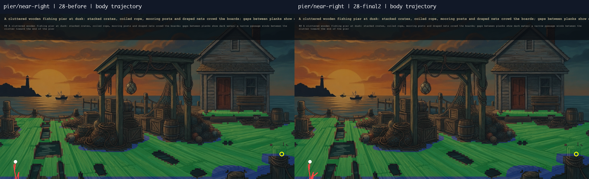
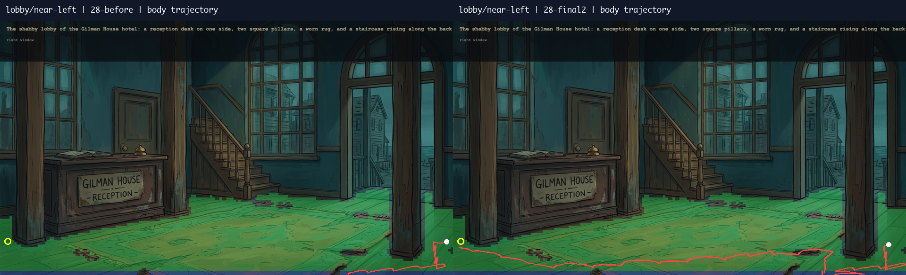
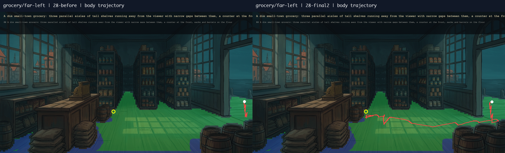
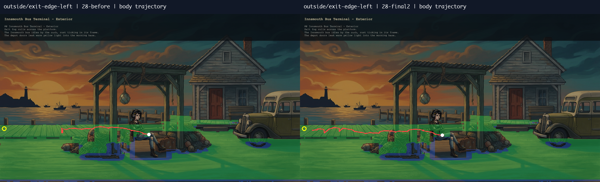

# Brief 28 — cornered starts

**Acceptance remains incomplete.** The simulator now records arrivals for all 139 walks and has zero reviewer-style stuck starts, but the 90% half-stride / 100% one-stride targets and the facing bar are not met. Pier/near-right remains a named implementation limitation; it is not declared geometrically impossible.

Branch `open-world-mvp`, starting commit `252a9d3`. Read the goal, brief 27, and the requested ten commits. Existing changes to `calls.md`, reviewer `walkstats.py`, and `AgentDebug.test.ts` were preserved. No reviewer tool was edited.

## Changes and measurements

- Standing pivots use either grounded boot. A standing pose showing the support transfer precedes a turn that would otherwise move the old sheet's planted boot. This repaired the 112 px lock failure in an intermediate experiment.
- First-stance body clearance begins at its actual entry drawing. Floor support is measured at the planted/landing soles; the first projected body may straddle a floor/caption boundary. Object footprints remain solid and the landing must be inside normal clearance. Later stances retain normal clearance checks. No facing tolerance was changed (30° / 35°).
- Up to eight improving stand-and-pivot continuations are planned before playback. Every segment settles before restarting; playback does not invoke search. Each search retains its 4,000-node cap, so a complete multi-segment request can exceed 4,000 expansions. This is bounded continuation, not a globally optimal search.
- Partial stops are scored by the remaining route around floor gaps, while arrival remains the actual geometric residual. Rejected continuation searches are included in the final rejection histograms.

| Run / change | Half stride | Within one stride | Beyond one stride | Missing arrival | Stuck | Facing / 139 | Max lock px | Off-floor frames | Object contacts |
|---|---:|---:|---:|---:|---:|---:|---:|---:|---:|
| Brief 26 | 12 / 116 | 26 / 116 | 90 | 21 | 28 | 86 | 59.63 | nonzero (inside return) | 0 |
| Brief 27 | 27 / 118 | 44 / 118 | 74 | 18 | 22 | 80 | 0 | 0 | 0 |
| [28-before](../sim/28-before/) — Reproduced 27 | 27 / 118 | 44 / 118 | 74 | 18 | 22 | 80 | 0 | 0 | 0 |
| [28-entry-fix](../sim/28-entry-fix/) — Actual entry origin | 27 / 119 | 44 / 119 | 75 | 17 | 21 | 82 | 0 | 0 | 0 |
| [28-pivot](../sim/28-pivot/) — Incoming-support pivots | 38 / 126 | 53 / 126 | 73 | 9 | 14 | 87 | 0 | 0 | 0 |
| [28-start-floor](../sim/28-start-floor/) — Raw first-stance body floor | 38 / 126 | 53 / 126 | 73 | 9 | 12 | 87 | 0 | 0 | 0 |
| [28-continue](../sim/28-continue/) — Runtime continuation experiment (replaced) | 73 / 119 | 96 / 119 | 23 | 9 | 12 | 69 | 0 | 0 | 0 |
| [28-segments](../sim/28-segments/) — Preplanned continuations | 78 / 120 | 96 / 120 | 24 | 9 | 12 | 73 | 0 | 0 | 0 |
| [28-standing-pivot](../sim/28-standing-pivot/) — Static-standing validation experiment (replaced) | 81 / 120 | 98 / 120 | 22 | 9 | 12 | 71 | 0 | 0 | 0 |
| [28-two-boot-pivot](../sim/28-two-boot-pivot/) — Either boot (lock failure; rejected) | 92 / 126 | 112 / 126 | 14 | 3 | 4 | 78 | 112.05 | 0 | 0 |
| [28-sole-start](../sim/28-sole-start/) — Sole-supported start (lock failure; rejected) | 91 / 127 | 110 / 127 | 17 | 2 | 3 | 78 | 99.36 | 0 | 0 |
| [28-transfer](../sim/28-transfer/) — Explicit support transfer | 91 / 127 | 110 / 127 | 17 | 2 | 3 | 78 | 1.32 | 0 | 0 |
| [28-route](../sim/28-route/) — Route score | 100 / 128 | 112 / 128 | 16 | 0 | 0 | 73 | 1.32 | 0 | 0 |
| [28-final](../sim/28-final/) — All attempted searches counted | 100 / 128 | 112 / 128 | 16 | 0 | 0 | 73 | 1.32 | 0 | 0 |
| [28-small-rest](../sim/28-small-rest/) — Small distant-stride continuations | 103 / 128 | 113 / 128 | 15 | 0 | 0 | 73 | 1.32 | 0 | 0 |
| [28-final2](../sim/28-final2/) — Final | 103 / 128 | 113 / 128 | 15 | 0 | 0 | 73 | 1.32 | 0 | 0 |

Final: **103 / 128 (80.5%) within half stride; 113 / 128 (88.3%) within one stride; 11 scene transfers; zero missing arrivals; zero stuck starts by the unchanged brief-27 definition** (same scene, target >150 px from first logged body, net body movement <40 px). This definition does not certify every short/unreachable click as successful. Facing passes fall from 80 to 73; settling and pivots do not waive the reviewer's reversal/run rules. Full per-walk results: [review28.json](../sim/28-final2/review28.json), [arrival reviewer](../sim/28-final2/arrival_vs_standable.log), [walkstats](../sim/28-final2/walkstats.log), [diagnostics](../sim/28-final2/diagnostics.json).

The arrival, facing, lock and walkstats reviewer tools ran on every retained simulator run, including diagnostic probes. `review28.py` is an orchestration script outside the reviewer-tools directory. Simulator runs read stored records only and make no network requests. Final corpus time: 25.243 s with browser/regression work overlapping; the preceding equivalent run took 21.975 s. This is slower than the brief-27 ~8 s baseline because bounded continuation searches add work.

## Four requested trajectories

White = first logged body position; red = body trajectory; yellow = target; blue = raw floor; green = clearance. Source-scene trajectories stop at transfer. Left is reproduced brief 27, right is final. Full histograms count all attempted plans, including discarded continuations.

| Case | Before residual px | Final source-scene residual px | Before → final expansions | Rejections |
|---|---:|---:|---:|---|
| pier/near-right | 1690.31 | 1668.04 | 7 → 59 | [before](../sim/28-before/pier/near-right-rejections.json), [after](../sim/28-final2/pier/near-right-rejections.json) |
| lobby/near-left | 1464.15 | 14.5 | 13 → 4141 | [before](../sim/28-before/lobby/near-left-rejections.json), [after](../sim/28-final2/lobby/near-left-rejections.json) |
| grocery/far-left | 1028.5 | 11.97 | 8 → 1008 | [before](../sim/28-before/grocery/far-left-rejections.json), [after](../sim/28-final2/grocery/far-left-rejections.json) |
| outside/exit-edge-left | 381.34 | 22.36 | 105 → 354 | [before](../sim/28-before/outside/exit-edge-left-rejections.json), [after](../sim/28-final2/outside/exit-edge-left-rejections.json) |

Outside/exit-edge-left now triggers `edge-left` exactly once and reaches the saved road scene. Lobby/near-left and grocery/far-left reach their requested corners. Pier/near-right still advances only about 89 px between its first and last logged body positions; it does not cross the deck. Its 59 explored states and the histogram above are retained as the specific unresolved corner case.

## Named arrival limitations

The following is the complete list beyond half stride, with actual reviewer ratios and full rejection histograms. These remain implementation limitations after pivot, support, first-stance and route-score attempts. No scenes were dropped. `nearest-reachable` means reachable in the bounded drawn-action graph, not proof of floor unreachability.

| Limitation | Half-stride multiples | Expanded | Outcome | Histogram |
|---|---:|---:|---|---|
| L28-inside-deepest | 2.35 | 1305 | nearest-reachable | [counts](../sim/28-final2/inside/deepest-rejections.json) |
| L28-inside-unreachable | 22.45 | 4000 | node-budget | [counts](../sim/28-final2/inside/unreachable-rejections.json) |
| L28-inside-object | 3.74 | 1169 | nearest-reachable | [counts](../sim/28-final2/inside/object-rejections.json) |
| L28-road-far-right | 10.11 | 5086 | nearest-reachable | [counts](../sim/28-final2/road/far-right-rejections.json) |
| L28-road-exit-edge-left | 1.46 | 3193 | nearest-reachable | [counts](../sim/28-final2/road/exit-edge-left-rejections.json) |
| L28-road-exit-edge-left-1 | 1.46 | 3193 | nearest-reachable | [counts](../sim/28-final2/road/exit-edge-left-1-rejections.json) |
| L28-road-exit-edge-left-2 | 1.46 | 3193 | nearest-reachable | [counts](../sim/28-final2/road/exit-edge-left-2-rejections.json) |
| L28-alley-unreachable | 19.86 | 364 | nearest-reachable | [counts](../sim/28-final2/alley/unreachable-rejections.json) |
| L28-pier-near-right | 30.43 | 59 | nearest-reachable | [counts](../sim/28-final2/pier/near-right-rejections.json) |
| L28-pier-far-left | 2.98 | 277 | nearest-reachable | [counts](../sim/28-final2/pier/far-left-rejections.json) |
| L28-pier-diagonal-away | 30.73 | 59 | nearest-reachable | [counts](../sim/28-final2/pier/diagonal-away-rejections.json) |
| L28-pier-occluder-behind | 1.84 | 358 | nearest-reachable | [counts](../sim/28-final2/pier/occluder-behind-rejections.json) |
| L28-pier-narrow-gap | 3.10 | 47 | nearest-reachable | [counts](../sim/28-final2/pier/narrow-gap-rejections.json) |
| L28-pier-unreachable | 34.27 | 42 | nearest-reachable | [counts](../sim/28-final2/pier/unreachable-rejections.json) |
| L28-pier-object | 2.03 | 458 | nearest-reachable | [counts](../sim/28-final2/pier/object-rejections.json) |
| L28-church-near-right | 1.15 | 239 | nearest-reachable | [counts](../sim/28-final2/church/near-right-rejections.json) |
| L28-church-diagonal-toward | 1.15 | 239 | nearest-reachable | [counts](../sim/28-final2/church/diagonal-toward-rejections.json) |
| L28-church-occluder-behind | 1.15 | 239 | nearest-reachable | [counts](../sim/28-final2/church/occluder-behind-rejections.json) |
| L28-church-occluder-back | 1.09 | 244 | nearest-reachable | [counts](../sim/28-final2/church/occluder-back-rejections.json) |
| L28-lobby-far-right | 5.34 | 12211 | nearest-reachable | [counts](../sim/28-final2/lobby/far-right-rejections.json) |
| L28-lobby-diagonal-away | 3.66 | 5869 | nearest-reachable | [counts](../sim/28-final2/lobby/diagonal-away-rejections.json) |
| L28-lobby-object | 1.77 | 8092 | nearest-reachable | [counts](../sim/28-final2/lobby/object-rejections.json) |
| L28-grocery-far-right | 2.46 | 3019 | nearest-reachable | [counts](../sim/28-final2/grocery/far-right-rejections.json) |
| L28-grocery-unreachable | 33.00 | 587 | nearest-reachable | [counts](../sim/28-final2/grocery/unreachable-rejections.json) |
| L28-square-deepest | 1.22 | 2459 | nearest-reachable | [counts](../sim/28-final2/square/deepest-rejections.json) |

## Final verification

- **487 tests / 52 files PASS**, typecheck PASS, lint PASS, `verify:art --generated` all scenes PASS. [Validation logs](../sim/28-final2/validation/).
- **Saved town replay 131 PASS**, including depot-left, road/alley travel and return, and both depot doors: **48 cached / 0 uncached calls**. [Replay record](../sim/28-final2/validation/town-131.json).
- The first launch used Vite's default API address and failed at boot; it was corrected by setting `VITE_API_BASE_URL` in the command environment. No dotenv files changed. Replay 130 then fixed depot-left but timed out at road→alley (18.83 px residual / 17.37 px half stride). The final 0.5 px continuation cutoff fixes that distant-stride case; full replay 131 passes. [Failed replay evidence](../sim/28-final/validation/town-130.json).
- **8 / 8 browser equivalence PASS**: outside, inside, road and alley × near-left/near-right. Every logged field compared with exact numeric equality, **0 differences, maximum numeric difference 0**, no excluded keys. [Comparison](../equivalence-28/diff-report.json), [source audit](../sim/28-final2/validation/browser-source-audit.json). MP4s and contact sheets accompany the logs. The earlier four-walk capture was interrupted to repair the road exit; the final eight are a fresh complete capture.
- Final brief-28 ledger: **170 cached / 0 uncached calls** across browser attempts, art checks and town replays. External HTTP/fetch was blocked by the cache-only preload and provider credentials were absent from the API child environment. [Call audit](../sim/28-final2/validation/call-audit.json).
- QA browser sessions closed. API **4317** and game **8080** stopped and verified absent; owner ports **4410/8090** were untouched. [Port check](../sim/28-final2/validation/stopped-ports.json). Temporary probe scripts, scratch logs and targeted fixture staging were removed; simulator evidence is retained.
- Production commits: `5604610` standing pivots and preplanned continuations; `68f35b4` obstacle-route scoring; `5c673ca` complete rejection accounting and compatibility; `72d9688` distant-stride continuation/caption regression. [Final source hashes](../sim/28-final2/validation/source-sha256.json).

No paid calls, push, merge, deployment, GitHub settings change, key write, dotenv edit, asset generation, or reviewer-tool edit was performed.

Full-corpus path/turn/slide/scale/depth and frame-freeze acceptance are not re-certified by this brief's four requested reviewer tools. The eight rendered browser walks are an equivalence spot-check, not full visual goal sign-off. The facing regression and named arrival limitations keep overall acceptance incomplete.
